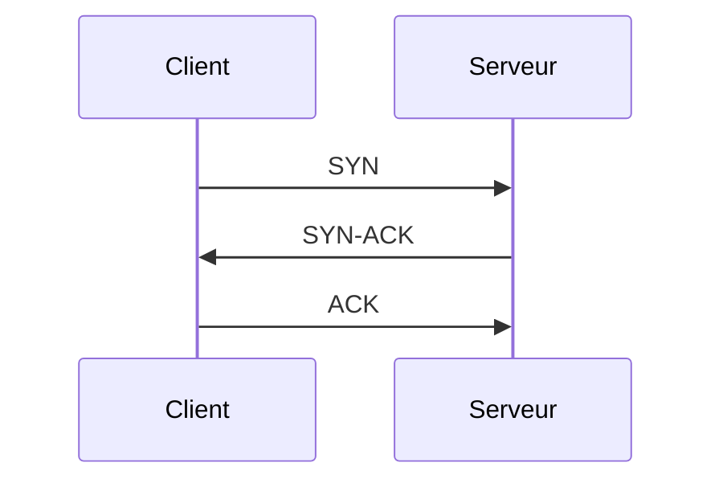

# Guide Cairn

> [!ASTUCE]
> Cette page est une **démo vivante** : chaque fonction y est utilisée pour de vrai.
> Appuie sur **Cmd+3** (côte à côte) pour voir à gauche ce qu'il faut écrire et à droite le résultat.
> Tu peux la modifier ou la supprimer : le menu **Aide › Guide de Cairn** la recrée.

## Premiers pas

- [ ] Créer une page avec **Cmd+N**
- [ ] Taper `/` dans l'éditeur pour voir toutes les commandes
- [ ] Chercher un mot avec **Cmd+K**
- [ ] Lier deux pages avec `[[Nom de la page]]`
- [ ] Ouvrir le tableau de bord avec **Cmd+Maj+D**

Ces cases sont cliquables dans l'aperçu, et apparaissent dans le widget « À faire » du tableau de bord.

## 1. Organiser le wiki

| Je veux… | Comment |
|---|---|
| Créer une page | **Cmd+N** : titre, modèle et dossier de destination |
| Créer un dossier | **Cmd+Maj+N** : n'importe où, racine comprise |
| Créer un autre wiki / en ouvrir un | **Cmd+Option+N** / **Cmd+O**, puis le sélecteur en haut de la barre latérale |
| Renommer, dupliquer, déplacer, supprimer | Clic droit sur la page ou le dossier (ou glisser-déposer) |
| Changer l'ordre | Clic droit › Monter / Descendre |
| Colorer un dossier | Clic droit › Couleur du dossier (12 couleurs) |
| Donner une page à un dossier | Crée un fichier `index.md` dans le dossier |
| Mettre une page en favori | **Cmd+D** |

Un wiki est un simple dossier de fichiers `.md` : lisible sans Cairn, synchronisable avec iCloud, sauvegardable comme n'importe quel dossier. Renommer une page met à jour les liens `[[…]]` qui pointent vers elle.

## 2. Écrire

### Les trois modes

**Cmd+1** Lecture · **Cmd+2** Édition · **Cmd+3** Côte à côte (l'aperçu suit le défilement) · **Cmd+Maj+F** Mode concentration · **Cmd+Maj+O** Sommaire de la page.

L'enregistrement est automatique (Cmd+S pour forcer). Cmd+F cherche dans la page en mode édition.

### Mise en forme

**Gras** (Cmd+B), *italique* (Cmd+I), `code` (Cmd+Maj+C), [lien web](https://www.ncsc.admin.ch), ~~barré~~.

- Liste à puces : Entrée ajoute un élément, Entrée sur un élément vide termine la liste
1. Liste numérotée : même principe

### Encadrés

> [!INFORMATION]
> `/information` : pour une précision.

> [!ASTUCE]
> `/astuce` : pour un conseil ou une bonne pratique.

> [!AVERTISSEMENT]
> `/avertissement` : pour un point de vigilance.

> [!ATTENTION]
> `/attention` : pour un danger ou une action risquée.

### Tableaux

`/table` ou **Cmd+Option+T**. Tab passe à la cellule suivante et réaligne le tableau ; Tab en fin de tableau ajoute une ligne.

| Port | Service | Remarque |
|---|---|---|
| 22 | SSH | Accès distant chiffré |
| 443 | HTTPS | Web chiffré |

### Code et commandes

`/bash`, `/powershell`, `/python`, `/yaml`, `/code`. Chaque bloc a un bouton **Copier** et affiche son langage.

```bash
nmap -sV -p 22,443 {{IP_CIBLE}}
```

### Images et documents

- **Cmd+V** d'une capture d'écran : l'image est rangée dans `assets/` à côté de la page.
- `![[assets/document.pdf]]` affiche un PDF dans la page ; clic sur une image ou un schéma pour l'agrandir.
- Une image hébergée sur Internet n'est téléchargée que si tu cliques dessus (réglable dans Réglages › Aperçu).

## 3. Relier les pages

- **Lien interne** : `[[Accueil]]` donne [[Accueil]]. Tape `[[` pour avoir des suggestions. Un lien rouge est une page à créer : clique dessus.
- **Texte différent** : `[[Accueil|retour au début]]` donne [[Accueil|retour au début]].
- **Mentionnée dans** : en bas de chaque page, la liste des pages qui la citent.
- **Carte des liens** (**Cmd+Maj+M**) : la page au centre, celles qui la citent à gauche, celles qu'elle cite à droite, celles qui partagent ses tags en bas.

## 4. Tags

- Dans l'en-tête de la page : `tags: guide, premiers pas` (seule la virgule sépare, les espaces sont permis).
- Dans le texte : #guide (un seul mot, pas dans le code).
- Clic sur un tag : recherche filtrée. Clic droit sur un tag : renommer, fusionner ou retirer partout.
- Barre latérale : les 12 tags les plus utilisés, et « Tous les tags » avec filtre au clavier.

## 5. Variables

Écris un nom entre doubles accolades (`/variable`), puis règle sa valeur dans la barre **Variables** au-dessus de la page. Elle est enregistrée dans l'en-tête (`vars:`). Cette page définit `IP_CIBLE` : change sa valeur, la commande ci-dessous suit.

```bash
ssh admin@{{IP_CIBLE}}
```

Les variables communes à tout le wiki se règlent dans Réglages › Modèles et variables.

## 6. Secrets (Trousseau)

Un mot de passe ne doit jamais être écrit dans une page. Enregistre-le dans **Réglages › Secrets**, puis écris `/secret` :

```bash
evil-winrm -i {{IP_CIBLE}} -u Administrator -p '{{secret:EXEMPLE}}'
```

- Le fichier ne contient que le nom. L'aperçu et les PDF affichent une clé 🔑 (rouge en pointillés tant que le secret n'existe pas, comme ici).
- La vraie valeur n'arrive que dans le presse-papiers : bouton **Copier** du bloc, **clic sur la clé**, ou sélection + Cmd+C. Elle est effacée après 60 secondes.

## 7. Schémas

### Flux simple (`/flux`)

```flux
Préparer > Détecter > Contenir > Éradiquer > Rétablir
Détecter > Faux positif ? > [oui] Clore
```

Une ligne = une chaîne d'étapes. `?` à la fin = décision, `(Début)` = case arrondie, `[oui]` = texte sur la flèche, une ligne `vertical` = de haut en bas.

### Schémas Mermaid

`/schema`, `/sequence`, `/classe`, `/etat`, `/activite`, `/er`, `/bpmn` (tape `/uml` pour tout voir). Une erreur de syntaxe est expliquée sous le schéma, avec la ligne fautive.



## 8. Réviser

### Questions et réponses masquées (`/question`, `/reponse`)

**Question :** Quel raccourci ouvre la recherche dans tout le wiki ?

> [!REPONSE]
> Cmd+K. Ajoute `#tag` pour filtrer par tag, ou choisis un dossier dans le menu sous le champ.

### Mode examen (**Cmd+Maj+X**)

Questions tirées au hasard des blocs `/question`, par dossier et/ou tag, avec chronomètre. Tu écris ta réponse, tu affiches la correction, tu te notes (Faux / Partiel / Juste). Note sur 6 selon le barème suisse, historique des 50 derniers examens, bouton « Refaire les questions ratées ».

### Tableau de bord (**Cmd+Maj+D**)

Bouton « Personnaliser » : chiffres clés, compte à rebours (date d'examen), question au hasard, tâches à faire, pages récentes, favoris, contenu d'un dossier, pages par section, note libre.

## 9. Retrouver

- **Cmd+K** : recherche dans tout le wiki, sans tenir compte des accents ni des majuscules.
- Filtres **Dossier** et **Tag** sous le champ, ou `#tag` directement dans la recherche.
- Mode **Code** : cherche seulement dans les blocs de code (pratique pour retrouver une commande).
- **Texte des images** : tes captures d'écran sont lues sur ton Mac (OCR) ; leurs résultats sont marqués 🖼.

## 10. Modèles de page

À la création (Cmd+N) ou avec `/` dans une page : `/cours`, `/revision`, `/lab`, `/incident`, `/glossaire`, `/cve`, `/mitre`, `/outil`, `/procedure`.

**Tes propres modèles** : chaque fichier `.md` du dossier `_Modèles/` devient un modèle et une commande `/` (Réglages › Modèles et variables pour créer le dossier).

## 11. Capture rapide

**⌃⌥N** depuis n'importe quelle app, ou l'icône ✎ de la barre des menus : une petite fenêtre, la première ligne devient le titre, **⌘↩** enregistre dans le dossier `Boîte-de-réception`. La page ouverte n'est pas dérangée.

## 12. Importer et exporter

| Action | Raccourci | Détail |
|---|---|---|
| Importer des documents | **Cmd+Maj+I** | Markdown, texte, Word, RTF, HTML, PDF, images (ou glisser depuis le Finder) |
| Exporter la page en PDF | **Cmd+Maj+E** | A4 ou Letter, réponses masquées incluses ou non (Réglages › Export) |
| Imprimer | **Cmd+P** | |
| Exporter tout le wiki | **Cmd+Option+E** | Un PDF par page, mêmes dossiers, dans un `.zip` |

## 13. Protéger une page

**Cmd+L** : la page est chiffrée sur le disque avec un mot de passe (AES-256-GCM).

> [!ATTENTION]
> - Pas de récupération : mot de passe perdu = page perdue.
> - Seul le texte est chiffré, pas les images ni les PDF joints.
> - Une page déverrouillée se reverrouille à la mise en veille, au verrouillage de la session et à la fermeture de l'app.
> - Les pages verrouillées ne sont ni indexées par la recherche (sauf leur titre) ni exportées en PDF.

## 14. Réglages (**Cmd+,**)

| Onglet | Ce qu'on y règle |
|---|---|
| Général | Nom du wiki, thème clair / sombre, OCR, capture rapide, mode à l'ouverture |
| Éditeur | Taille du texte, délai d'enregistrement automatique |
| Aperçu | Taille et largeur du texte, retours à la ligne, schémas, images distantes |
| Modèles et variables | Modèle par défaut, modèles proposés, variables globales |
| Secrets | Mots de passe du Trousseau utilisables avec `/secret` |
| Export | Format du papier, réponses masquées dans les PDF |

## 15. Tous les raccourcis

| Raccourci | Action |
|---|---|
| Cmd+N / Cmd+Maj+N | Nouvelle page / nouveau dossier |
| Cmd+Option+N / Cmd+O | Nouveau wiki / ouvrir un wiki existant |
| Cmd+K | Rechercher dans le wiki |
| Cmd+1 / 2 / 3 | Lecture / Édition / Côte à côte |
| Cmd+Maj+F | Mode concentration |
| Cmd+Maj+O | Sommaire de la page |
| Cmd+Maj+D | Tableau de bord |
| Cmd+Maj+X | Mode examen |
| Cmd+Maj+M | Carte des liens |
| Cmd+D | Favori |
| Cmd+L | Verrouiller / reverrouiller la page |
| Cmd+Maj+I | Importer des documents |
| Cmd+Maj+E / Cmd+P | Exporter en PDF / imprimer |
| Cmd+Option+E | Exporter tout le wiki (.zip) |
| Cmd+S / Cmd+R | Enregistrer / relire le dossier |
| Cmd+B / Cmd+I / Cmd+Maj+C | Gras / italique / code |
| Cmd+Option+T / Cmd+Option+C | Insérer un tableau / une commande bash |
| Cmd+F | Rechercher dans la page (édition) |
| ⌃⌥N | Capture rapide, depuis n'importe quelle app |
| Cmd+, | Réglages |
